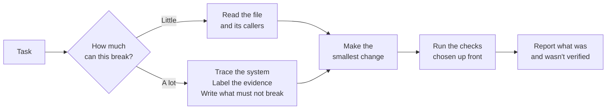

<div align="center">

# X-RAY

**An evidence-based engineering skill for AI coding agents working on existing code.**

Understand the system before changing it. Change only what the task needs. Prove the result with evidence, not confidence.

[](#limitations)
[](CHANGELOG.md)
[](#quick-start)
[](https://agentskills.io/specification)
[](LICENSE)
[](https://github.com/Skarycloud/x-ray/actions/workflows/validate.yml)

</div>

> [!IMPORTANT]
> **X-RAY is experimental.** Pilots on Claude Code show the skill loads on code-shaped requests, but it hasn't yet been shown to improve results over a baseline: in the first outcome pilot, the agent didn't invoke it, and the baseline already avoided the trap. Nothing in this repository claims X-RAY improves agent results. See [Limitations](#limitations) and [Evaluation](#evaluation).

---

## Contents

- [Why X-RAY](#why-x-ray)
- [How it works](#how-it-works)
- [Quick start](#quick-start)
- [Usage](#usage)
- [Example: one task, start to finish](#example-one-task-start-to-finish)
- [Design choices driven by published evidence](#design-choices-driven-by-published-evidence)
- [Standards checklist](#standards-checklist)
- [When to use it](#when-to-use-it)
- [Repository layout](#repository-layout)
- [Evaluation](#evaluation)
- [Security](#security)
- [Limitations](#limitations)
- [Roadmap](#roadmap)
- [Contributing](#contributing)
- [Research references](#research-references)
- [License](#license)

---

## Why X-RAY

AI coding agents often write plausible code faster than they understand the system they're changing. The failures tend to follow a chain:

1. **Incomplete context.** The agent reads files without reconstructing how they connect.
2. **Wrong assumptions.** It infers behavior from a function name or a stale doc.
3. **A locally plausible change.** The edit looks right in isolation.
4. **An unseen regression.** A caller, data consumer, shared component, or config path breaks elsewhere.
5. **False confidence.** A passing build, or no check at all, gets reported as "fixed".

Other skills already cover planning, TDD, debugging, minimal code, and framework rules well (see [Research references](#research-references)). X-RAY doesn't replace them. Its focus is the part that connects them: **establishing what is true about the existing system, deciding what must not break, and reporting only what was actually verified.**

## How it works

X-RAY is a workflow in [`skills/x-ray/SKILL.md`](skills/x-ray/SKILL.md). An agent loads it when a task involves changing existing code.

**In plain terms:** before editing, the agent works out how risky the change is, finds out what actually depends on the code it's about to touch, and writes down what must keep working. After editing, it runs the checks it picked in advance and tells you exactly what it verified and what it didn't. Small tasks stay small; risky ones get more care.



See [Example: one task, start to finish](#example-one-task-start-to-finish) for the whole workflow applied to a realistic task.

### 1. Size the task first

Every task is sorted into a risk tier before any investigation. The tier sets how deep every later step goes, in both directions: no shortcuts on risky work, no bureaucracy on trivial work.

| Tier | Typical change | Investigation | Verification |
| --- | --- | --- | --- |
| **Lightweight** | Typo, copy, local style, isolated private function | The touched file and its direct callers | Nearest test or check; read the diff |
| **Integrated** | Feature or fix across modules, shared UI component, new dependency | Callers, data flow, config, and tests for affected paths | Relevant suites, build/typecheck, exercise the changed path |
| **Critical** | Public API, schema, auth, payments, migrations, security fixes | Full impact analysis with recorded evidence | All of the above, plus a regression test per invariant and a rollback note |

The tier depends on **what the change can break, not how small it looks**. A one-line change to an authorization check is Critical.

### 2. Follow ten steps, scaled to the tier

```text
 1. Define the task          goal, checkable acceptance criteria, out of scope
 2. Read the house rules     AGENTS.md / CLAUDE.md / CI config; docs are claims to check
 3. Trace the system         entry point → execution path → callers, data, config, tests
 4. Keep an evidence ledger  label every load-bearing claim (see below)
 5. Write the contract       outcomes that must become true, invariants that must stay true
 6. Choose verification      before editing, so the change can't shape the test
 7. Make the smallest change reuse first; no speculative abstractions or drive-by refactors
 8. Respect the design system tokens, components, states, accessibility, motion
 9. Verify with real results run the checks, read the output, stop when the contract is covered
10. Review and report        read the full diff; report what was and wasn't verified
```

### 3. Separate facts from guesses

Every claim the change depends on gets one of four labels:

| State | Meaning | Required support |
| --- | --- | --- |
| **CONFIRMED** | Observed directly in this session | `file:line`, a command and its output, a test result |
| **INFERRED** | Concluded from evidence, not observed | What it rests on and why the inference holds |
| **UNKNOWN** | Not known, and it matters | How it could be resolved |
| **CONTRADICTED** | Sources disagree (doc vs code, test vs implementation) | Both sources, and which one is trusted and why |

The agent may not present an INFERRED claim as CONFIRMED, and may not build on a load-bearing UNKNOWN.

### 4. Precedence

The user's task comes first, then the target repository's own instructions, versions, and paths, then X-RAY. Examples and templates in this skill are illustrations, never requirements.

## Quick start

### Claude Code (plugin, recommended)

```text
/plugin marketplace add Skarycloud/x-ray
/plugin install x-ray@x-ray
```

This is the same mechanism Anthropic's own skills repository uses. Tested on Claude Code 2.1.131 with a local copy of this marketplace: it installed, enabled, and registered the skill as `x-ray:x-ray`. Installing straight from GitHub hasn't been tested yet.

### Any host (plain skill folder)

The skill is the [`skills/x-ray/`](skills/x-ray/) folder. Copy that folder, not the whole repository:

```bash
git clone https://github.com/Skarycloud/x-ray.git
cp -r x-ray/skills/x-ray ~/.agents/skills/   # Codex, Cursor, Copilot, Gemini CLI (shared user path)
cp -r x-ray/skills/x-ray ~/.claude/skills/   # Claude Code, if you don't use the plugin
```

Gemini CLI can also install it directly: `gemini skills install https://github.com/Skarycloud/x-ray.git --path skills/x-ray`.

> [!NOTE]
> Keep the copied folder named `x-ray`: the Agent Skills spec requires the folder name to match the skill's `name`. The plain-folder installs follow each host's official docs but haven't been tested with X-RAY.

Project-scope paths, Windows commands, and the source for each host's behavior are in the adapter files:

| Host | Adapter | Host docs support `SKILL.md` | Tested with X-RAY |
| --- | --- | --- | --- |
| Claude Code | [adapters/claude-code.md](adapters/claude-code.md) | Yes | Plugin install; trigger and outcome pilots ([results](adapters/claude-code.md#test-record)) |
| OpenAI Codex | [adapters/codex.md](adapters/codex.md) | Yes | No |
| Cursor | [adapters/cursor.md](adapters/cursor.md) | Yes | No |
| GitHub Copilot | [adapters/copilot.md](adapters/copilot.md) | Yes | No |
| Gemini CLI | [adapters/gemini-cli.md](adapters/gemini-cli.md) | Yes | No |

**Optional: always-on pointer.** If your agent doesn't invoke X-RAY on its own, [adapters/always-on-pointer.md](adapters/always-on-pointer.md) has a four-line snippet for the target repo's `AGENTS.md`, `CLAUDE.md`, or `GEMINI.md`. It's experimental and kept short on purpose, because always-loaded text has its own cost.

## Usage

**Automatic.** Hosts that support Agent Skills read the skill's `description` and load X-RAY when a task matches, for example:

> Fix the 500 error when an order uses a 100% discount code.

> Add an optional `locale` parameter to `formatPrice` without breaking existing callers.

**Explicit.** Invoke it by name where the host supports it: `/x-ray:x-ray` in Claude Code with the plugin (`/x-ray` as a plain skill), `$` or `/skills` in Codex, `/` in Cursor's agent chat. Explicit invocation is the reliable option for feature requests: in the outcome pilot, a natural request ("Show prices in German format…") didn't trigger X-RAY on its own.

**Alongside other skills.** If a more specific skill applies (TDD, debugging, a framework guide, a design system), X-RAY tells the agent to use it inside the matching step.

## Example: one task, start to finish

> [!NOTE]
> This example is illustrative. It shows what each step asks the agent to do in a made-up codebase. It isn't output from a recorded agent run.

**The request:** *"Show prices in German format for our German customers."*

**The trap.** The obvious fix is to make the shared `formatPrice` helper use the customer's locale everywhere. It looks like a one-file change. But in this codebase the invoice generator reads the formatted price back as a number. Switch to German format (`1.234,50 €`) and the invoice code reads a total of 1234.50 as 1.2345. The `formatPrice` tests still pass, and the agent reports "Done, tests pass."

Here's how each X-RAY step catches it.

**Step 0: Size it.** `formatPrice` is shared across the app, so this is **Integrated**, not Lightweight, even though the edit itself will be small.

**Step 1: Define done.**

```text
Goal: German customers see prices in German format.
AC1:  formatPrice(1234.5, "EUR", "de-DE") returns "1.234,50 €"
AC2:  Every existing call without a locale returns exactly what it returns today
Out of scope: currency conversion, translating other text
```

**Step 2: Read the house rules.** The repo's `AGENTS.md` says to run `pnpm test`, and CI also runs `pnpm typecheck`. Those become the checks, instead of whatever the agent would guess.

**Step 3: Trace what depends on it.**

```text
$ rg -n "formatPrice\("
14 call sites: cart, checkout, order emails, ... and:
src/invoice/pdf.ts:58   parseFloat(formatPrice(total, cur).replace(/[^0-9.]/g, ""))
```

That last line is the trap: the invoice code parses the formatted text.

**Step 4: Label the evidence.**

```text
[CONFIRMED]    formatPrice has 14 callers.        source: rg -n "formatPrice\("
[CONTRADICTED] README says formatPrice is "display only", but src/invoice/pdf.ts:58
               parses its output. Trusting the code; flagging the README.
[UNKNOWN]      Does the mobile app also use this helper?   resolve: ask the mobile team
```

**Steps 5 and 6: Write what must stay true, and how each item will be checked**, before touching any code.

```text
O1  German format when locale "de-DE" is passed          → new unit test
I1  Output with no locale unchanged for every currency    → existing 12 price tests
I2  Invoice totals unchanged                              → tests/invoice.test.ts
I3  No new dependency                                     → package.json diff is empty
```

**Step 7: Make the smallest change.** Add an optional `locale` parameter to `formatPrice` and pass it to `Intl.NumberFormat`, which the helper already uses. With no locale passed, the helper behaves exactly as before, so the invoice code is untouched. Only the storefront's price component passes the customer's locale. No new library.

**Step 8: Design.** No layout or styling changes, so this step adds nothing here.

**Step 9: Verify, then stop.** All checks run after the last edit:

```text
pnpm test -- price      13 passed (12 existing + 1 new)
pnpm test -- invoice     6 passed
pnpm typecheck           0 errors
```

Every item in the contract now has a passing check, so verification stops. No extra full-suite reruns "just to be sure".

**Step 10: Review the diff and report.**

```text
Changed:  src/lib/price.ts: optional locale parameter
          src/components/Price.tsx: passes the customer's locale
Verified: price tests 13/13, invoice tests 6/6, typecheck clean (all after the final edit)
Not verified / risks:
  - Whether the mobile app uses formatPrice is UNKNOWN (question sent to the mobile team)
  - README.md:41 wrongly calls formatPrice display-only; flagged, not changed (out of scope)
```

**The difference:**

| | A plausible shortcut | With X-RAY |
| --- | --- | --- |
| The change | Locale applied to every call | Opt-in parameter; default unchanged |
| Invoices | Silently wrong | Unchanged, and covered by a test |
| The report | "Done, tests pass." | What was checked, plus the open question about mobile |

### And a trivial task

A Lightweight change skips almost all of that and ends with a three-line report:

```text
Changed: src/components/Footer.tsx: fixed copyright year typo
Verified: pnpm test -- Footer → 4 passed, 0 failed
Not verified / risks: none
```

More worked examples are in [skills/x-ray/references/](skills/x-ray/references/), and the full report formats are in [skills/x-ray/templates/VERIFICATION_REPORT.md](skills/x-ray/templates/VERIFICATION_REPORT.md).

## Design choices driven by published evidence

Recent studies of agent skills shaped several rules. These choices follow from the studies' findings; whether they help X-RAY specifically is untested.

| Finding | X-RAY response |
| --- | --- |
| Most public software-engineering skills produced no pass-rate gain, and a few reduced it, attributed to guidance that conflicted with the project's own context (SWE-Skills-Bench) | Precedence rule: the task and target repo override the skill's examples and templates. The repo's code wins over its docs. |
| The largest source of skill-induced efficiency loss was excessive procedure, led by excessive verification (Dong et al.) | An explicit stop rule for verification; templates only when the work doesn't fit in a few lines; tiers bound depth in both directions. |
| Skills often turned checklists and recipes into mandatory work, and agents changed environments to satisfy them (Dong et al.) | Examples are labeled illustrative; "don't change the environment to make a check pass" is a rule. |
| Focused skills with a few modules outperformed exhaustive bundles (SkillsBench) | A short core workflow (about 120 lines); detail lives in references loaded only when a step needs it. |
| In Vercel's evals, agents never invoked an available skill in 56% of cases; an always-loaded pointer helped, but "you MUST invoke" wording made agents ignore project context | Optional four-line [always-on pointer](adapters/always-on-pointer.md) that says "explore first, then use X-RAY". |
| Always-loaded context files didn't generally improve success and raised cost by over 20% (Gloaguen et al.) | The pointer is a reminder, not the workflow, and is marked experimental. |
| Hosts tend to under-trigger skills, and descriptions that summarize the workflow invite agents to skip the body (Anthropic `skill-creator`, Superpowers `writing-skills`) | The `description` leads with when to use it, in phrases users actually type. [Trigger queries](evals/trigger-queries.md) test it. |
| 94% of real skills lack guards against rationalizing away steps, and 71% lack progress tracking (Hong et al.) | A "Gotchas" table of tempting thoughts, covering both skipping steps and overdoing them, and an optional checklist for Integrated and Critical work. |
| Build evaluations before extensive documentation, and compare against a no-skill baseline (Anthropic skill-authoring guidance; `claude plugin eval`) | **Followed late:** X-RAY was written before its evals. Eval cases now exist in the official `claude plugin eval` format, with a first paired pilot. |

## Standards checklist

How X-RAY compares with the practices of Anthropic's [skills repository](https://github.com/anthropics/skills), the [Agent Skills spec](https://agentskills.io/specification), Anthropic's [authoring guidance](https://platform.claude.com/docs/en/agents-and-tools/agent-skills/best-practices), and widely used open-source skill repositories ([Superpowers](https://github.com/obra/superpowers), [Vercel agent-skills](https://github.com/vercel-labs/agent-skills), [Ponytail](https://github.com/DietrichGebert/ponytail)).

| Practice | Where it comes from | X-RAY |
| --- | --- | --- |
| Skill at `skills/<name>/SKILL.md`, separate from repo docs | Anthropic, Superpowers, Vercel, Ponytail, OpenAI portable plugins | ✅ [`skills/x-ray/`](skills/x-ray/SKILL.md) |
| Claude Code plugin marketplace (`.claude-plugin/`) | Anthropic, Superpowers, Ponytail | ✅ installs and registers (local test) |
| Valid frontmatter; `name` matches folder | Agent Skills spec | ✅ checked in CI by the official `skills-ref` |
| Manifests validated by the host's own tool | Claude Code docs | ✅ `claude plugin validate` in CI |
| `SKILL.md` under 500 lines; references one level deep | Spec; authoring guidance | ✅ 143 lines; all references linked from `SKILL.md` |
| Description says what and when, with user phrasing | Spec; `skill-creator`; Superpowers `writing-skills` | ✅ trigger-tested: 10/10 and 0/10 on code-shaped requests |
| Workflow checklist and guards against skipped steps | Authoring guidance; SKILL.md smell study | ✅ optional checklist; "Gotchas" table |
| License file inside the skill | Anthropic, OpenAI skills | ✅ [`skills/x-ray/LICENSE`](skills/x-ray/LICENSE) |
| Evals with a no-skill baseline, 3+ runs | Authoring guidance; `claude plugin eval` | ⚠️ 3 cases in the official format; one paired pilot, inconclusive |
| Tested with each model you plan to use | Authoring guidance | ❌ only `claude-opus-4-7` so far |
| Disclaimer: test before relying on it for critical work | Anthropic skills README | ✅ status notice and [Limitations](#limitations) |
| Changelog, security policy, issue templates | Common open-source practice | ✅ [CHANGELOG](CHANGELOG.md), [SECURITY](SECURITY.md), issue forms |

## When to use it

| Good fit | Poor fit |
| --- | --- |
| Bug fixes in unfamiliar code | Greenfield prototypes with no existing behavior to preserve |
| Features that touch shared modules or public interfaces | Throwaway scripts |
| Refactors where behavior must stay identical | Pure research or writing tasks |
| UI changes inside an established design system | |
| Changes to data, auth, payments, or migrations (Critical tier) | |

### Principles

- Understand before changing.
- Distinguish confirmed facts from assumptions.
- Trace dependencies and assess change impact.
- Preserve important existing behavior.
- Avoid unnecessary abstractions and dependencies.
- Treat design quality and functional correctness as engineering requirements.
- Verify actual results rather than trusting generated code.
- Report uncertainty and limitations honestly.
- Scale investigation and verification to the risk of the change.

## Repository layout

The skill is the `skills/x-ray/` folder; everything else supports it.

```text
x-ray/
├── skills/x-ray/                    The skill (this folder is what gets installed)
│   ├── SKILL.md                     The authoritative, portable workflow
│   ├── references/                  Detailed procedures, loaded on demand
│   │   ├── reverse-engineering.md   Tracing entry points, call paths, consumers, tests
│   │   ├── evidence-ledger.md       Evidence states, entry format, durable ledger
│   │   ├── invariant-contracts.md   Writing outcomes and invariants before editing
│   │   ├── change-impact-analysis.md  Finding consumers, rating blast radius, safe-change patterns
│   │   ├── verification.md          Choosing checks by tier, running them honestly, when to stop
│   │   ├── design-engineering.md    Tokens, states, accessibility, responsiveness, motion
│   │   └── security-boundaries.md   Permissions, untrusted content, secrets, unsafe actions
│   ├── templates/                   Optional formats, each with a short form
│   └── LICENSE
├── .claude-plugin/                  Claude Code plugin manifest and marketplace
├── adapters/                        Per-host install notes and the optional always-on pointer
├── evals/                           Method, rubric, eval cases, trigger and outcome harnesses, results
├── tools/validate.py                Repository checks (stdlib only), run in CI
├── .github/                         CI (repo checks, skills-ref, plugin validate) and issue forms
├── AGENTS.md                        Rules for agents and humans editing this repo
├── CHANGELOG.md · CONTRIBUTING.md · SECURITY.md
└── LICENSE
```

## Evaluation

X-RAY's claim to usefulness has to come from measurement, not from how well its instructions read. The method is defined in [evals/README.md](evals/README.md):

- **Paired runs.** The same model, host, prompt, and repository snapshot, with and without X-RAY, at least 5 runs per condition.
- **Graders.** Outcome checks for the task, plus invariant checks for behavior the task never mentions. Cases use the official [`claude plugin eval`](https://code.claude.com/docs/en/plugin-evals) format, so anyone can run them with one command.
- **Metrics** ([scoring-rubric.md](evals/scoring-rubric.md)): task success, regressions, patch quality, visual correctness, evidence accuracy (how often the final report claims something false), calibration, procedure overhead, and cost.
- **Tasks chosen to expose harm too:** trivial changes where X-RAY should add no overhead, and tasks where the repo's requirements conflict with the skill's examples.
- **Negative results get published.** A "no gain" result is realistic: in SWE-Skills-Bench, most public software-engineering skills showed none.

**Current status** (Claude Code 2.1.131, `claude-opus-4-7`):

| Pilot | Result |
| --- | --- |
| [Trigger](adapters/claude-code.md#test-record), 20 queries × 1 run | Loaded on 10/10 code-shaped change requests, 0/10 unrelated ones |
| [Outcome](evals/outcome-harness/README.md), `price-locale-trap`, 3 runs per arm | **Inconclusive.** X-RAY was installed but not invoked (0/3) on a natural feature request, and the baseline caught the hidden invoice consumer in every completed run. All completed runs reported honestly that tests couldn't be run. |
| Outcome, `footer-year` (overhead) | **No result:** every run hit the account's usage limit |

Whether X-RAY improves results is still unknown.

## Security

Skills run with the agent's permissions, and malicious skills are a documented supply-chain risk ([OWASP Agentic Skills Top 10](https://owasp.org/www-project-agentic-skills-top-10/)). For X-RAY specifically:

- **The skill is Markdown only.** It has no scripts, hooks, or `allowed-tools` grants. `tools/validate.py` is for checking this repository in CI; the skill never tells an agent to run it.
- **It tells the agent to treat repository content as untrusted data** and to ask before destructive or outward-facing actions. See [security-boundaries.md](skills/x-ray/references/security-boundaries.md).
- **Install from this repository only, and read what you install.** The plugin pins to the version in its manifest; for a plain-folder install, copy from a specific commit or [release](CHANGELOG.md).

To report a problem, see [SECURITY.md](SECURITY.md).

## Limitations

- **No demonstrated benefit yet.** The one paired outcome pilot was inconclusive (see [Evaluation](#evaluation)). In SWE-Skills-Bench, 39 of 49 public software-engineering skills produced no pass-rate gain; X-RAY may land in that group.
- **Natural feature requests may not trigger it.** It loaded on 10/10 code-shaped requests but 0/3 times on "Show prices in German format for our German customers." Invoke it explicitly, or try the [always-on pointer](adapters/always-on-pointer.md), for feature work. A description change is planned, pending a re-run of the trigger tests.
- **One host, one model.** Everything measured so far is Claude Code with `claude-opus-4-7`. Other hosts and smaller models are untested.
- **Overhead unmeasured.** The trivial-task case exists but hasn't produced a result yet.
- **Instruction-only.** X-RAY can't force an agent to follow it; compliance depends on the model and host. The skill ships no scripts by design, so there's nothing to execute and less to trust.

## Roadmap

Planned, not implemented:

1. **Finish the pilot.** Run `footer-year` and re-run `price-locale-trap` with 3+ runs per arm, using `claude plugin eval` once available.
2. **Harder cases.** Add cases the baseline fails: traps that need cross-file tracing a strong model skips, stale docs that look authoritative, and repo rules that conflict with the skill's examples. Run a smaller model too.
3. **Triggering on feature requests.** Revise the description for phrasings like "show…", "support…", "make X do Y", then re-run all trigger queries, held-out ones included.
4. **Other hosts.** Run the [validation checklist](adapters/README.md#validation-checklist-for-a-host-to-do-before-marking-tested) on Codex, Cursor, Copilot, and Gemini CLI.
5. **Revision from evidence.** Cut or change any step the evals show to be ineffective or costly.

## Contributing

The most useful contributions are **evidence**: host test reports, eval cases the baseline fails, and documented cases where an agent following X-RAY did something wrong or wasteful. Issue forms for host reports and failure reports are ready to use. See [CONTRIBUTING.md](CONTRIBUTING.md), and read [AGENTS.md](AGENTS.md) before editing: its rules apply to human contributors too.

## Research references

These works informed X-RAY's design. They're cited for attribution. None of them endorses X-RAY, and no text has been copied from them.

<details>
<summary><strong>Skill format and existing skills</strong></summary>

- Agent Skills specification. https://agentskills.io/specification. Skill format, frontmatter rules, progressive disclosure.
- Anthropic. *Skill authoring best practices.* https://platform.claude.com/docs/en/agents-and-tools/agent-skills/best-practices. Conciseness, one-level references, evaluation-driven development.
- Anthropic, *anthropics/skills*. https://github.com/anthropics/skills. Example skills and template structure.
- Jesse Vincent / Prime Radiant, *obra/superpowers* (MIT). https://github.com/obra/superpowers. Its verification-before-completion, test-driven-development, and systematic-debugging skills cover adjacent ground; X-RAY is meant to work alongside them.
- Vercel Labs, *vercel-labs/agent-skills* (MIT). https://github.com/vercel-labs/agent-skills. Focused, domain-specific skills that X-RAY should defer to when they apply.
- *Ponytail* (MIT). https://github.com/DietrichGebert/ponytail. Its "reuse before writing" ladder informed the reuse order in `SKILL.md` step 7 (paraphrased), including the rule that validation, data-loss handling, security, and accessibility are never cut.

</details>

<details>
<summary><strong>Research on agent skills</strong></summary>

- Li et al. *SkillsBench: Benchmarking How Well Agent Skills Work Across Diverse Tasks.* arXiv:2602.12670, 2026. Paired with/without-skill evaluation; focused skills outperformed exhaustive bundles.
- Han et al. *SWE-Skills-Bench: Do Agent Skills Actually Help in Real-World Software Engineering?* arXiv:2603.15401, 2026. Most SWE skills showed no gain; harm traced to guidance conflicting with project context.
- Dong et al. *Agent Skills Can Be Harmful: An Empirical Study of Skill-Induced Failures in LLM Agents.* arXiv:2608.11888, 2026. Failure taxonomy; excessive verification and procedure as the main efficiency regressions.
- Hong, Imani, Ahmed. *From Anatomy to Smells: An Empirical Study of SKILL.md in Agent Skills.* arXiv:2607.01456, 2026. Taxonomy of 26 skill smells; X-RAY was audited against it.
- Gloaguen et al. *Evaluating AGENTS.md: Are Repository-Level Context Files Helpful for Coding Agents?* arXiv:2602.11988, 2026. Context files didn't generally improve success and raised cost by over 20%.
- Gao (Vercel). *AGENTS.md outperforms skills in our agent evals.* 2026. https://vercel.com/blog/agents-md-outperforms-skills-in-our-agent-evals. Skills went uninvoked in 56% of cases; pointer wording mattered.
- Anthropic, `skill-creator` skill. https://github.com/anthropics/skills. Under-triggering, trigger-query evaluation, explaining why rather than shouting rules.
- Jesse Vincent, `writing-skills` in *obra/superpowers*. https://github.com/obra/superpowers. Trigger-only descriptions; rationalization tables.
- OWASP. *Agentic Skills Top 10.* https://owasp.org/www-project-agentic-skills-top-10/. Malicious skills as a supply-chain risk.

</details>

<details>
<summary><strong>Research on coding agents</strong></summary>

- Jimenez et al. *SWE-bench: Can Language Models Resolve Real-World GitHub Issues?* ICLR 2024. arXiv:2310.06770.
- Zhang et al. *RepoCoder: Repository-Level Code Completion Through Iterative Retrieval and Generation.* EMNLP 2023. arXiv:2303.12570. Repository context matters; motivates task-scoped tracing.
- Yang et al. *SWE-agent: Agent-Computer Interfaces Enable Automated Software Engineering.* NeurIPS 2024. arXiv:2405.15793.
- Xia et al. *Agentless: Demystifying LLM-based Software Engineering Agents.* arXiv:2407.01489, 2024. Localize, repair, validate as a strong simple baseline.
- Aider polyglot benchmark. https://aider.chat/docs/leaderboards/. Exercism exercises in six languages, scored by executable tests.

</details>

<details>
<summary><strong>Software engineering and industry research</strong></summary>

- Winters, Manshreck, Wright. *Software Engineering at Google.* O'Reilly, 2020. Hyrum's Law (consumers depend on observable behavior), which underpins the invariant and impact-analysis steps.
- Ousterhout. *A Philosophy of Software Design.* Yaknyam Press, 2018. Complexity as the core cost; caution against shallow, speculative abstractions.
- Hermans. *The Programmer's Brain.* Manning, 2021. How developers read and build models of unfamiliar code; informs the reverse-engineering procedure.
- DORA. *State of AI-assisted Software Development 2025.* Google, 2025. https://dora.dev/research/ai. Finds AI amplifies an organization's existing strengths and weaknesses; X-RAY therefore makes no general productivity claim.

</details>

<details>
<summary><strong>Design and accessibility</strong></summary>

- Emil Kowalski's writing on UI and animation. https://emilkowal.ski. Purposeful, fast, interruptible motion; informs the motion guidance in `skills/x-ray/references/design-engineering.md`.
- W3C. *Web Content Accessibility Guidelines (WCAG) 2.2.* https://www.w3.org/TR/WCAG22/.

</details>

## License

[MIT](LICENSE) © 2026 Sumanth Kumar
